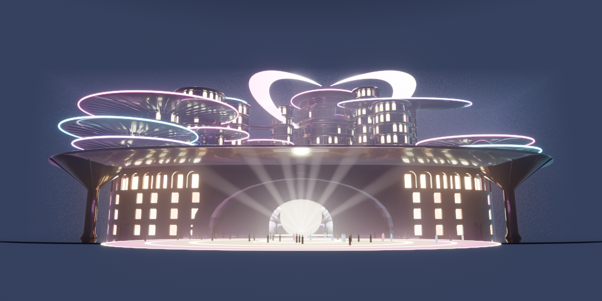
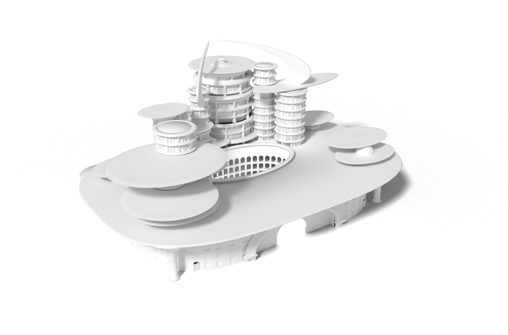

# Complex Architecture / 复杂建筑

Procedural Blender building (white-clay massing → detailed structure) + three.js orbit/walk preview.
程序化 Blender 建筑（参数驱动）+ three.js 环绕/漫游预览。

Live preview / 在线预览: https://complex-architecture.pages.dev (Cloudflare Pages, deployed from `web/` on push to `main`).






## Run locally / 本地预览

```bash
cd web && python3 -m http.server 8765    # open http://localhost:8765/
```
Controls / 操作: Orbit / Walk · WASD · mouse look · Shift run · R/F lift.

## Pipeline / 流程

Every dimension lives in `params.json` (tagged measured / inferred in `params_table.md`); all geometry is generated from it.
所有尺寸都在 `params.json`（`params_table.md` 标注“图纸量取 / 推断”），几何体全部由参数生成。

```bash
COMPARE_ROUNDS=4 ./run_all.sh
```
1. `compare/ref_extract.py` – reference elevation silhouettes (needs `ref/sheet_elevations.png`, not included in this repo).
2. `compare/compare_loop.py` – silhouette IoU + skyline error vs the reference (design target: front/rear stretched by
   `global.ref_stretch_x` for the widened plaza, side elevations strict via `ref_stretch_y` = 1), coordinate-descent tuning of the knobs, log in `compare_log.md`.
3. `build.py` (+ `src/geom.py`, `src/detail.py`) – Blender 5 headless build: exterior, interior (rooms/doors/stairs/lifts),
   `building.blend`, `building.glb`, `spaces.json`.
4. `src/render_clay.py` – true-ortho clay elevations, hero views, tower close-up.
5. `check/circulation_check.py` – circulation graph BFS + door/wall raycasts + stair riser/tread/headroom + lift shafts,
   with a negative test (blocked door must make the check fail) → `circulation_report.md`.
6. gltf-transform – Meshopt + GPU instancing → `web/building_opt.glb` (< 25 MiB).
7. `walk/walk_test.py` – headless Chrome walk through the web preview (WASD keys, penetration rays, stuck detection, doors).
8. `src/final_render.py` – Cycles mood render (AgX, volumetric arch beams, pink/cyan rims, glowing plaza).

管线：参考立面剪影 → 剪影对比与参数自动调优 → Blender 无头建模（外观+室内）→ 白模渲染 → 流线检查（含反向测试）→
glTF 压缩导出 → 无头 Chrome 漫游测试 → 氛围渲染。每次修改脚本后整条管线重跑，保证不回退。

Requirements / 依赖: Blender 5.x, Python 3 (numpy, scipy, Pillow, matplotlib, playwright), Node + `@gltf-transform/cli`, Chrome.

## Layout / 目录
- `web/` – static site (deployed) / 静态站点（部署目录）
- `build.py`, `src/` – Blender generation / Blender 生成脚本
- `check/` – circulation checks / 流线检查
- `compare/` – silhouette compare + tuning loop / 剪影对比与调参
- `walk/` – headless walk test / 漫游测试
- `docs/` – renders, change notes, walk result / 渲染图、变更说明、漫游结果

Deploy mirrors [cyber-louvre](https://github.com/xuzhiming/cyber-louvre): push `main` → GitHub Actions → Cloudflare Pages.
