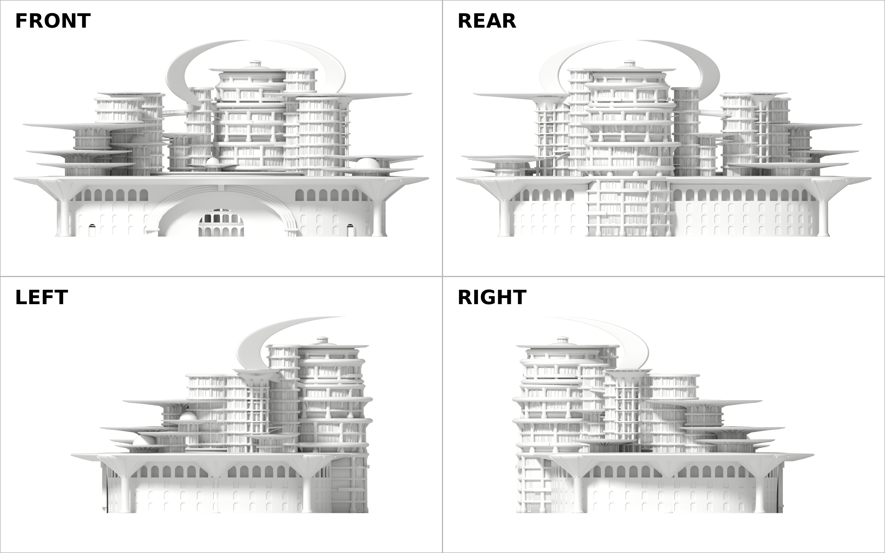
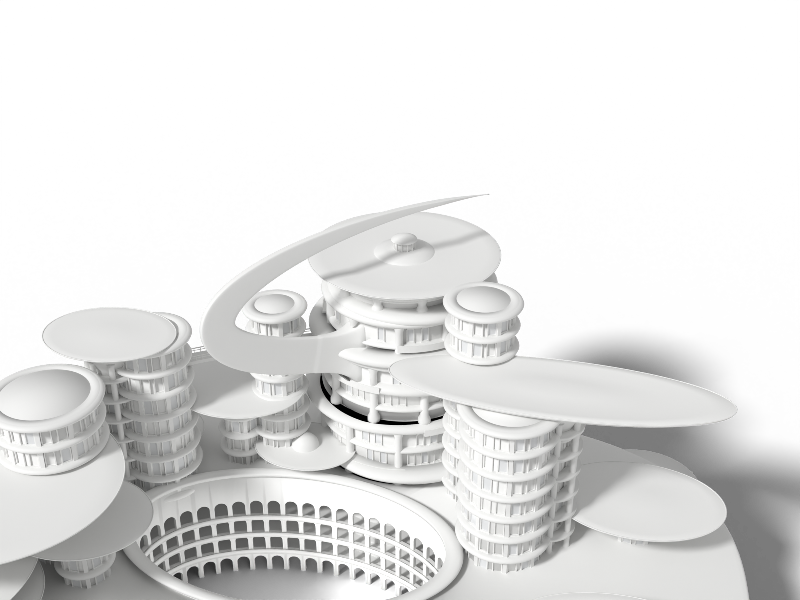
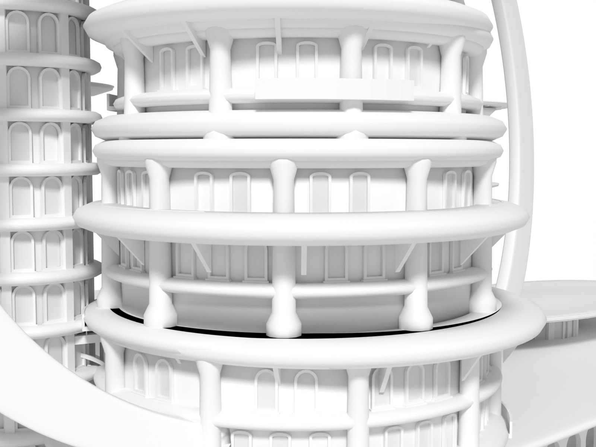
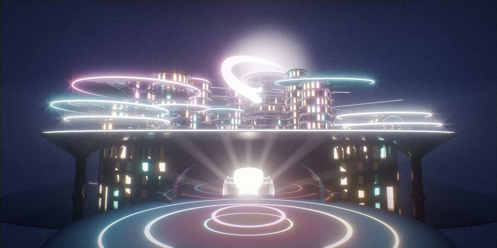
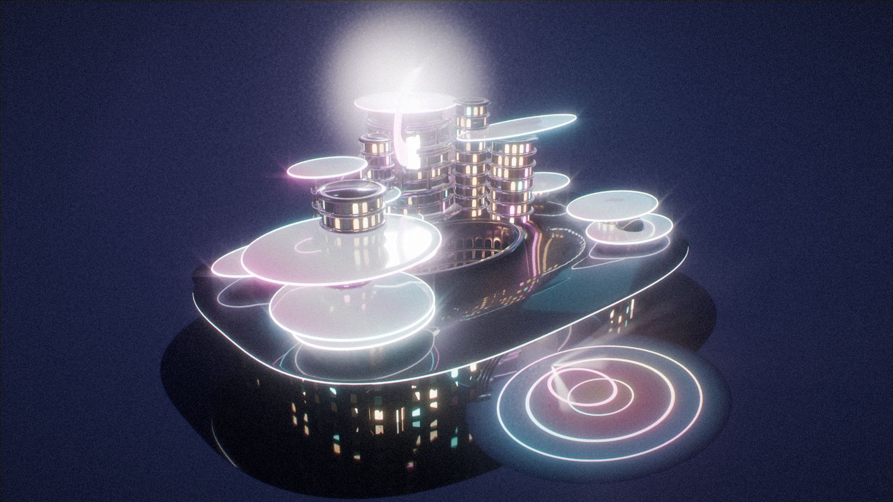
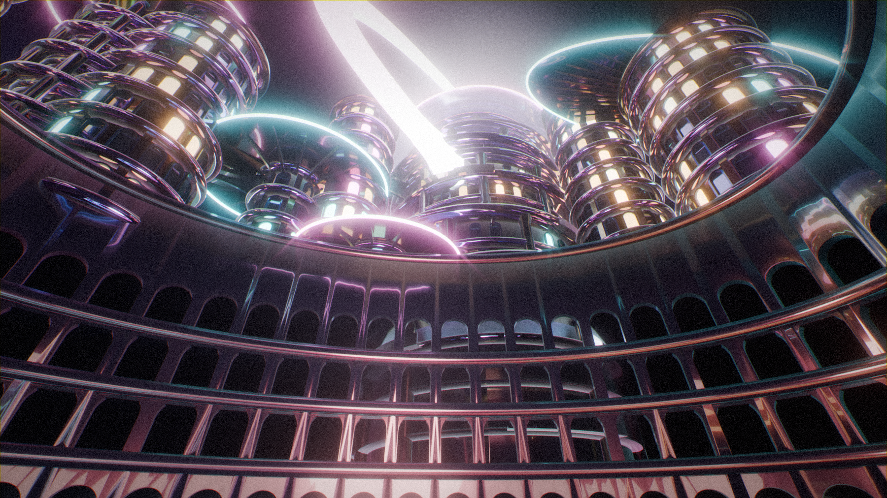

# Complex Architecture / 复杂建筑

Procedural Blender building (white-clay massing → detailed structure) + three.js orbit / walk / fly preview.
程序化 Blender 建筑（参数驱动）+ three.js 环绕/漫游预览。

Live preview / 在线预览: https://complex-architecture.pages.dev (Cloudflare Pages, deployed from `web/` on push to `main`).







## Run locally / 本地预览

```bash
cd web && python3 -m http.server 8765    # open http://localhost:8765/
```
Controls / 操作 (buttons 环绕 Orbit / 漫游 Walk / 飞行 Fly, top right):
- **Orbit 环绕:** drag rotate · wheel zoom · right-drag pan.
- **Walk 漫游 (Tab):** WASD · click for mouse look (Esc releases) · Shift run · R/F lift up/down inside a lift car.
- **Automatic doors 自动门 (all modes):** all 92 real doors are automatic: 40 interior/gallery/tower doors, 2 exterior side-wing
  doors and 50 lift doors. Each one is a split double sliding leaf (glazed panel in a clay frame) that slides into the wall
  pockets. It opens when you come within 2.8 m (walk: the player, on that floor) or 3.0 m (fly: the camera). Opening and
  closing are eased (≈0.45 s open, ≈0.7 s close), with a 0.7 s hold after you leave, and the frame shows a faint cool rim glow
  while the door is active. Closed leaves are solid and block you; the gap opens up as they slide. **Lift doors** open only
  while the car stands at that floor. Walking up to one calls the nearest car (3 m/s), and a car leaves only after its doors
  have shut. The 14 open archways have no leaves: the arch portal, the tunnel→courtyard mouth, 2 tunnel side openings and
  10 courtyard→gallery arcade openings.
  全部 92 扇门都是自动门：靠近约 2.8 m 时双扇玻璃移门向两侧滑开，离开后停留 0.7 s 再关上。门关着时不能穿过。
  电梯门只在轿厢停在本层时开启，走近时会呼叫电梯。14 处开敞拱券没有门扇。
- **Fly 飞行 (F toggles):** free 6-DoF camera, no gravity, no collision (passes through walls). Click for mouse look, Esc releases ·
  WASD along the view direction · Space/E up · Q/C down · Shift ×3 boost · wheel or +/− base speed · 1–5 preset viewpoints
  (forecourt, arch, courtyard, crown, aerial) · T auto tour (arch → courtyard → over the crown → around). Entering fly keeps the
  current camera pose; switching to Walk drops you onto the floor below. Touch: one-finger drag looks, two-finger drag moves,
  ▲/▼ buttons rise/sink.

**Style 风格 (V or the 风格 Style button):** two looks, **渲染 Render** (the default) and **白模 Clay**, the v13 white model.
  Render uses the model's own colours, metal/roughness and glow (exported in the glb) on a dark blue-violet gradient
  background with fog and bloom. It adds glowing pastel rings on the forecourt plaza, a warm glow in the arch and a pastel
  halo around the crown. Clay swaps in two plain white materials and the old daylight. Walk, fly and the automatic doors
  work the same in both looks. Use `?style=clay` to open in Clay.
风格切换（V 键或「风格」按钮）：默认「渲染」，即蓝紫色夜景、发光边缘、泛光；可切换回「白模」。

## Stylised render / 风格化渲染 (v14)




`src/render_style.py` is a Blender Cycles script. It assigns every material by rule from `params.json` → `style.rules`
(matching an object-name pattern or a role), so nothing is set by hand.
- **Materials:** dark glossy saucers with iridescent lips, stacked glossy tower rings, glass with tiny warm, amber and teal
  window lights, a pale glowing crescent ribbon, and a dark podium with a light strip along the deck edge.
- **Light and atmosphere:** a warm-white starburst through the arch, pastel plaza rings, a volumetric haze domain with
  god rays, and a pastel halo around the crown.
- **Compositor and finish:** Bloom and Streaks glare in the compositor, then `src/style_post.py` adds grain, chromatic
  softness and a vignette.
- **Backdrop:** an abstract gradient with a few faint light streaks; no city and no people.
- **Web light:** Render is a night scene with three families of colour — warm gold on the podium, arch and windows; cyan on the saucer edges and floor bands; rose and violet on the crescent and crown. Saucer and bridge tops are a readable blue-slate, not a black metal and not a glowing disc. Exposure stays near 0.9. Bloom is a short halo, not a white fog. Clay lights, materials and exposure are the daylight white model and are not shifted with Render. The Cycles stills above are from the earlier render; `style.web` and `style.cycles` now describe this palette for the next Blender export, which has not been run.

## Pipeline / 流程

Every dimension lives in `params.json` (tagged measured / inferred in `params_table.md`); all geometry is generated from it.
所有尺寸都在 `params.json`（`params_table.md` 标注“图纸量取 / 推断”），几何体全部由参数生成。

```bash
COMPARE_ROUNDS=4 ./run_all.sh
```
1. `compare/ref_extract.py` – reference elevation silhouettes (needs `ref/sheet_elevations.png`, not included in this repo).
2. `compare/compare_loop.py` – silhouette IoU + skyline error vs the reference (design target: front/rear stretched by
   `global.ref_stretch_x` for the widened plaza, side elevations strict via `ref_stretch_y` = 1), coordinate-descent tuning of the knobs, log in `compare_log.md`.
3. `build.py` (+ `src/geom.py`, `src/detail.py`) – Blender 5 headless build: exterior, interior (rooms/doors/stairs/lifts),
   `building.blend`, `building.glb`, `spaces.json`.
4. `src/render_clay.py` – true-ortho clay elevations, hero views, tower close-up.
5. `check/circulation_check.py` – circulation graph BFS + door/wall raycasts + stair riser/tread/headroom + lift shafts,
   with a negative test (blocked door must make the check fail) → `circulation_report.md`.
6. `tools/export_style_glb.py`, then gltf-transform – bake the Render materials into the glb, then Meshopt + GPU instancing → `web/building_opt.glb` (the v14 check rejects anything over 8 MB; Cloudflare Pages rejects a file over 25 MiB).
7. `walk/walk_test.py` – headless Chrome walk through the web preview (WASD keys, penetration rays, stuck detection, doors).
   v13 adds three checks:
   - an auto-door coverage check (every door in `spaces.json` maps to two animated leaves);
   - a scripted pass through 13 doors of every type, which logs open-on-approach, the gap at crossing and close-after-leaving;
   - a fly-mode door check.
   `walk/fly_test.py` – headless fly-mode test (pose hand-over, no gravity/collision, over the crown, through the courtyard, speed, presets, tour, drop to walk).
8. `src/final_render.py` – Cycles mood render (AgX, volumetric arch beams, pink/cyan rims, glowing plaza; no people).
9. `src/render_style.py` + `src/style_post.py` – v14 stylised renders → `renders/style_front|aerial|courtyard.png`.
   Step 6 first bakes the Render look into the glb (`tools/export_style_glb.py`), and step 7 also runs
   `walk/style_shots.py`, which checks the Render/Clay toggle with no console errors and the glb under 8 MB.

管线：参考立面剪影 → 剪影对比与参数自动调优 → Blender 无头建模（外观+室内）→ 白模渲染 → 流线检查（含反向测试）→
风格材质烘焙与 glTF 压缩导出 → 无头 Chrome 漫游/飞行/自动门/风格切换测试 → 氛围渲染 → v14 风格化渲染。每次修改脚本后整条管线重跑，保证不回退。

Requirements / 依赖: Blender 5.x, Python 3 (numpy, scipy, Pillow, matplotlib, playwright), Node + `@gltf-transform/cli`, Chrome.

## Layout / 目录
- `web/` – static site (deployed) / 静态站点（部署目录）
- `build.py`, `src/` – Blender generation / Blender 生成脚本
- `check/` – circulation checks / 流线检查
- `compare/` – silhouette compare + tuning loop / 剪影对比与调参
- `walk/` – headless walk + fly tests / 漫游、飞行测试
- `docs/` – renders, change notes, walk + fly results (`docs/fly/` screenshots, `docs/doors/` auto-door screenshots) / 渲染图、变更说明、漫游与飞行结果

Deploy mirrors [cyber-louvre](https://github.com/xuzhiming/cyber-louvre): push `main` → GitHub Actions → Cloudflare Pages.
